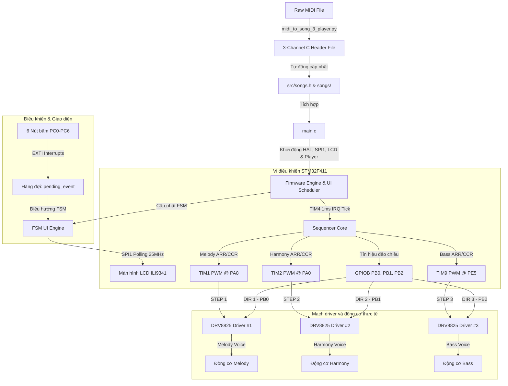

# 🎵 Hệ Thống Phát Nhạc Bè Bằng Động Cơ Bước (3-Channel Stepper Motor Music System)

Hệ thống phát nhạc đa âm sắc 3 kênh (Polyphonic) độc đáo chạy trên mạch vi điều khiển **STM32F411E-DISCO** (ARM Cortex-M4), tích hợp màn hình hiển thị màu **LCD ILI9341** và bộ điều hướng **6 nút bấm ngắt ngoài GPIOC**.

Hệ thống sử dụng các động cơ bước **NEMA17** để trực tiếp co kéo cơ học tạo ra các bước sóng rung tần số âm thanh cơ khí chân thực và độc đáo, không dùng loa hay còi chip truyền thống.

---

## 🎨 Các tính năng nổi bật (Key Features)

*   **Đa âm cơ khí 3 bè song song (3-Channel Polyphony):** Phân tách và chơi đồng thời bè chính (Melody), bè đệm (Harmony) và bè trầm (Bass) trên 3 động cơ bước thông qua các Timer độc lập (`TIM1`, `TIM2`, `TIM9`).
*   **Giao diện đồ họa đa trạng thái (FSM UI):** Màn hình hiển thị màu LCD ILI9341 hoạt động ở tần số SPI 25MHz cực cao với giao diện Sleek Dark Mode huyền bí.
*   **Cuộn chữ tự động (Auto-scroll):** Tiêu đề bài hát dài và danh sách thành viên Credits được cuộn trơn trượt mượt mà theo thời gian thực (định thì bằng SysTick ngắt nền).
*   **Điều hướng bằng phím bấm ngắt ngoài (6-Button GPIOC EXTI):** Hỗ trợ Lên, Xuống, Chọn (Play/Pause), Quay lại, Tua trái (Bài trước), Tua phải (Bài sau) với thuật toán chống rung (software debounce) bằng `HAL_GetTick()`.
*   **Trình chuyển đổi nhạc MIDI thông minh:** Script Python tự động tách bè từ file `.mid` bất kỳ, tự động generate code C và nhúng trực tiếp vào danh sách nhạc của firmware.

---

## 🔌 Sơ đồ khối hệ thống (System Architecture)



---

## 📂 Danh mục tài liệu hướng dẫn (Project Documentation)

Để nhanh chóng vận hành và phát triển hệ thống, bạn có thể tham khảo các tài liệu hướng dẫn chi tiết bằng Tiếng Việt sau đây:

*   📘 **[lcd_porting_guide.md](file:///d:/step-motor-media-player-t/lcd_porting_guide.md)**: Hướng dẫn sơ đồ nối dây phần cứng giữa STM32 với màn hình LCD ILI9341 và 6 nút bấm GPIOC. Giải thích chi tiết kiến trúc code lai (Hybrid), cách cấu hình ngắt ngoài và cơ chế chống Hard Fault màn hình.
*   🎵 **[add_song_guide.md](file:///d:/step-motor-media-player-t/add_song_guide.md)**: Hướng dẫn từng bước cách sử dụng script Python `midi_to_song_3_player.py` để tự chuyển đổi file nhạc MIDI của riêng bạn và tự động nạp vào bộ nhớ hệ thống.
*   🗺️ **[project_summary.md](file:///d:/step-motor-media-player-t/project_summary.md)**: Tài liệu tóm tắt kỹ thuật tổng quan của toàn bộ hệ thống bằng Tiếng Anh, bao gồm bảng ma trận sơ đồ chân đầy đủ, thông số cấu hình Driver DRV8825 và các giải pháp chống tranh chấp ngắt.

---

## ⚡ Hướng dẫn biên dịch và nạp chương trình (Build & Flash)

Dự án sử dụng PlatformIO trên nền trình biên dịch GCC ARM mang lại tốc độ build tối ưu:

1.  **Cài đặt thư viện Python phụ trợ (dành cho script chuyển đổi nhạc):**
    ```bash
    pip install mido
    ```
2.  **Biên dịch dự án:**
    Sử dụng nút biên dịch (✓) của PlatformIO trong VS Code hoặc chạy lệnh terminal:
    ```powershell
    C:\Users\PC\.platformio\penv\Scripts\pio.exe run
    ```
3.  **Nạp chương trình xuống mạch:**
    Sử dụng nút mũi tên (→) của PlatformIO hoặc chạy lệnh:
    ```powershell
    C:\Users\PC\.platformio\penv\Scripts\pio.exe run --target upload
    ```

---

*Chúc các bạn có những giây phút trải nghiệm âm nhạc cơ học tuyệt vời cùng STM32 Electromechanical Music!* 🎧🔩