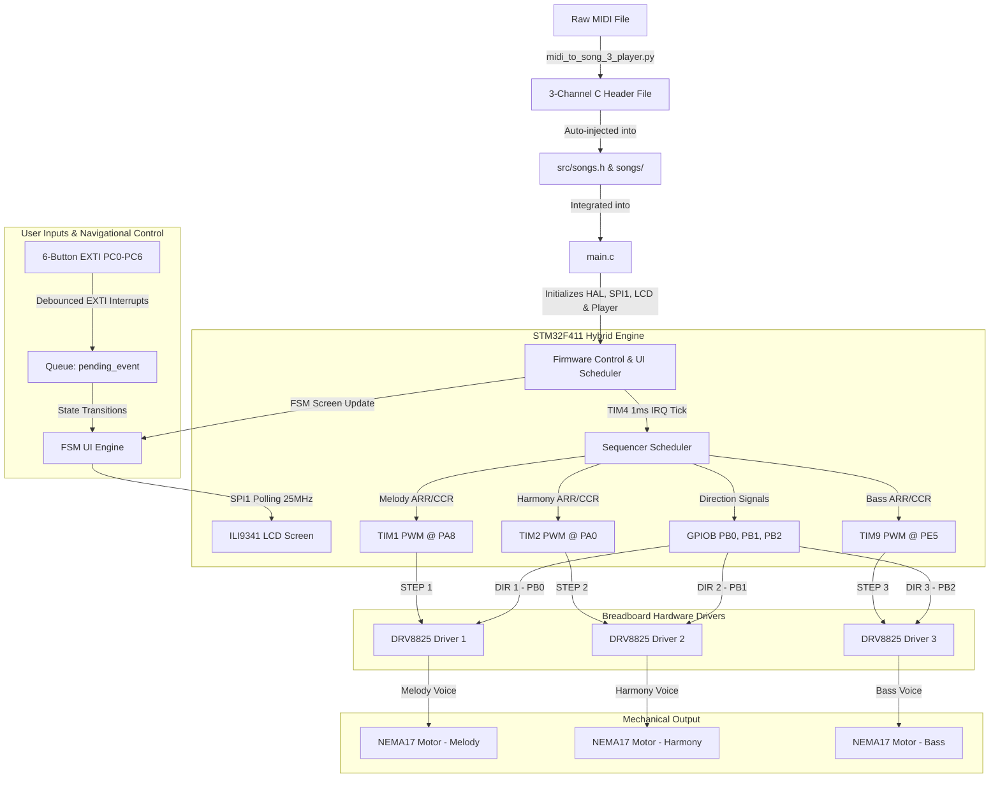

# STM32 Electromechanical Music System — Project Summary

> [!NOTE]
> This document details the architectural specifications, hardware connections, firmware logic, and MIDI converter tools for the **3-Channel Polyphonic Stepper Motor Music System with ILI9341 LCD and 6-Button GPIOC Navigational Menu** running on the **STM32F411E-DISCO** board.

---

## 🗺️ System Architecture

The following Mermaid diagram visualizes the flow of data from raw MIDI files to synchronized mechanical sound generation across 3 channels, fully integrated with a real-time ILI9341 LCD FSM (Finite State Machine) GUI and a 6-button navigation interface:



---

## 🔌 Hardware Configuration & Pinout Mapping

The system utilizes three independent NEMA17 stepper motors as sound sources, where each step pulse commands a mechanical detent movement that translates directly to an audible pitch. A 320x240 ILI9341 LCD displays the real-time UI, and 6 physical buttons on GPIOC provide precise navigation.

### 📍 Pinout Matrix

| Peripheral / Module | Pin | Function | Mode / Configuration | Hardware Destination |
| :--- | :--- | :--- | :--- | :--- |
| **Stepper Motor 1 (Melody)** | **PA8** | TIM1_CH1 PWM Step Pulse | Bare-metal PWM Output | STEP Pin on DRV8825 Driver #1 |
| | **PB0** | GPIO General Output | Bare-metal Direction Signal | DIR Pin on DRV8825 Driver #1 |
| **Stepper Motor 2 (Harmony)**| **PA0** | TIM2_CH1 PWM Step Pulse | Bare-metal PWM Output | STEP Pin on DRV8825 Driver #2 |
| | **PB1** | GPIO General Output | Bare-metal Direction Signal | DIR Pin on DRV8825 Driver #2 |
| **Stepper Motor 3 (Bass)** | **PE5** | TIM9_CH1 PWM Step Pulse | Bare-metal PWM Output | STEP Pin on DRV8825 Driver #3 |
| | **PB2** | GPIO General Output | Bare-metal Direction Signal | DIR Pin on DRV8825 Driver #3 |
| **ILI9341 LCD Display** | **PA5** | SPI1_SCK (Clock) | HAL SPI Master (25 MHz) | SCK Pin on LCD |
| | **PA7** | SPI1_MOSI (Data Out) | HAL SPI Master (25 MHz) | MOSI Pin on LCD |
| | **PA4** | GPIO General Output | Active LOW Select | CS Pin on LCD |
| | **PA3** | GPIO General Output | Data/Command Register Select | D/C Pin on LCD |
| | **PA2** | GPIO General Output | Active LOW Reset | RES Pin on LCD |
| **Navigational Buttons** | **PC0** | EXTI0 Interrupt Line | Input Pull-Up (Falling Edge) | BTN_UP (Move Up / Credits Scroll Up) |
| | **PC1** | EXTI1 Interrupt Line | Input Pull-Up (Falling Edge) | BTN_DOWN (Move Down / Credits Scroll Down) |
| | **PC2** | EXTI2 Interrupt Line | Input Pull-Up (Falling Edge) | BTN_LEFT (Previous Track / Fast Rewind) |
| | **PC4** | EXTI4 Interrupt Line | Input Pull-Up (Falling Edge) | BTN_SELECT (Play/Pause Song or Select Item) |
| | **PC5** | EXTI9_5 Interrupt Line | Input Pull-Up (Falling Edge) | BTN_BACK (Go Back / Return to Main Hub) |
| | **PC6** | EXTI9_5 Interrupt Line | Input Pull-Up (Falling Edge) | BTN_RIGHT (Next Track / Fast Forward) |

### 🛠️ DRV8825 Driver Settings
* **Enable (EN) Pin:** Connected directly to **GND** (Drivers are always enabled and energized).
* **Reset & Sleep Pins:** Tied together and pulled up to **3.3V**.
* **Microstepping Config:** All microstepping pins (M0, M1, M2) are connected to **GND** for **Full-Step Mode**, ensuring maximum step torque, sharpest physical transient, and highest acoustic sound volume.
* **Grounding:** All driver grounds share a common ground with the STM32 board.

---

## 💻 Firmware Engine Architecture

The firmware uses a **Hybrid Architecture** combining high-efficiency bare-metal register operations for motor control and high-level STM32Cube HAL drivers for the graphical display interface:

### 1. Clock Configuration (`clock_init`)
* **Source:** High-Speed Internal (HSI) oscillator @ 16MHz.
* **PLL Configuration:** Multiplied up to **100MHz** system clock speed.
* **Buses:** APB1 prescaler set to 4 (timers run at 100MHz clock frequency), APB2 prescaler set to 1.
* **HAL Systick:** Driven by calling `HAL_Init()` first in `main()` to configure Systick interrupt timebase, while keeping PLL clock configurator active for dynamic high-speed peripheral clocks.

### 2. PWM Pitch Generation (TIM1, TIM2, TIM9)
* **Timer Input Clock:** Configured with a prescaler `PSC = 99`, dividing the timer clock down to **1MHz**.
* **PWM Configuration:** TIM1, TIM2, and TIM9 are configured in **PWM Mode 1** with Preload enabled.
* **Pitches & ARR:** Note pitches are set by updating the Auto-Reload Register (`ARR`) from the precomputed lookup table in `notes.h`.
* **Duty Cycle & Volume:** The Capture/Compare Register (`CCR1`) manages the pulse-width duty cycle.
* **Per-Motor Volume Control:** Dynamic volumes map to `CCR1 = (ARR * volume) / 200`, capping at a **50% square wave** for maximum audio resonance.

### 3. Multi-Channel Sequencer & Scheduler (TIM4)
* **Time Base:** TIM4 is configured to trigger a periodic update interrupt every **1ms** (`PSC = 999`, `ARR = 99`).
* **Sequencer Logic:**
  * Tracks individual song progression for all three voices simultaneously using the `VoiceState` structure.
  * Monitors note duration countdowns (`dur_ms`) in the Interrupt Service Routine (`TIM4_IRQHandler`).
  * Implements **Smooth Note Switching**: Updates both ARR and CCR1 registers and immediately triggers an Event Generation update (`EGR = TIM_EGR_UG`) without disabling the timer, eliminating clicking sounds.

### 4. Robust 6-Button GPIOC Navigational Inputs
* **Debounced Interrupts:** Physical buttons on `PC0`, `PC1`, `PC2`, `PC4`, `PC5`, `PC6` are mapped to EXTI lines with internal Pull-Up resistors.
* **EXTI Handlers:** Capture button presses on the falling edge, implement a 200ms software lockout timer (`HAL_GetTick()`) to remove mechanical chatter, and push valid events (`BTN_UP`, `BTN_SELECT`, etc.) to the atomic queue `pending_event`.
* **Thread Safety:** The main loop pops items from `pending_event` in an interrupt-disable critical section (`__disable_irq()`, `__enable_irq()`) to prevent race conditions.

### 5. ILI9341 LCD Driver & FSM UI Engine
* **High-Speed Polling SPI:** Operates SPI1 at a prescaler of 4 (25 MHz clock rate) in standard **Polling mode** (`HAL_SPI_Transmit`). This guarantees highly robust frame transfer and **100% protection against Hard Faults** (which are otherwise triggered by unconfigured DMA SPI pipelines).
* **FSM UI States:**
  * `STATE_MAIN_CHOICE`: Home screen to select between Music List or Group Credits.
  * `STATE_MENU`: Vertical-scrolling list of 5 songs, highlighting selections in vibrant Yellow and supporting auto-scrolling titles for long names.
  * `STATE_MUSIC_PLAYER`: "Now Playing" dashboard featuring song title autoscroll, playback status icons (` > ` for play, `||` for pause), and track skip arrows.
  * `STATE_CREDITS`: Elegant, scrollable vertical roll of development group members.
* **Anti-Flicker Rendering:** Background redraws are strictly locked by state transitions, clearing only the active layout region (Y=36 to Y=221) exactly once during state switching.

---

## 🐍 MIDI-to-Song Python Converter

The project includes an advanced utility **`midi_to_song_3_player.py`** to automatically convert multi-track MIDI files into compile-ready C header files and register them into the firmware.

### Key Capabilities:
1. **Dynamic Track Separation:** Splits overlapping MIDI sequences into three separate monophonic voices:
   * **Melody Tracker:** Selects notes based on the closest musical distance to the previous melody note, avoiding large pitch jumps.
   * **Bass Tracker:** Automatically isolates the lowest note playing at any given time step.
   * **Harmony Tracker:** Isolates the highest remaining note in the chord that is neither melody nor bass.
2. **Note Segment Generation:** Uses precise event times to partition the music rather than fixed-interval slices, maximizing musical accuracy.
3. **Dual Duration Formats:** Supports both auto-mapping to pre-defined duration macro names (e.g. `MS_Q`, `MS_H`) or exporting raw durations in milliseconds with the `--raw` flag.
4. **Auto-Patching Engine:** The script automatically updates `src/songs.h` by inserting the correct `#include` line and appending a populated `Song3` struct to the `song_list[]` array.

### Command Usage:
```bash
python midi_to_song_3_player.py path/to/song.mid "Song Name" [--raw]
```

---

## 📂 File Directory Structure

```
d:/step-motor-media-player-t/
├── include/
│   ├── fonts.h                # Font size interfaces and configurations
│   ├── font.h                 # Unicode and character metrics definitions
│   ├── font8.h                # Glyphs data for small Font_7x10
│   ├── font16.h               # Glyphs data for medium Font_11x18 and large Font_16x26
│   ├── ili9341.h              # ILI9341 commands, colors, control pin macros and draw functions
│   └── stm32f4xx_hal_conf.h   # Core configuration file enabling HAL modules (SPI, GPIO, RCC, CORTEX)
├── src/
│   ├── main.c                 # Application entry point; handles SPI1/GPIO init, FSM states and UI draw loops
│   ├── player.c               # Stepper motor sequencer; manages tim1/2/9 PWM, tim4 1ms IRQ, 6-button GPIOC EXTI and Pause/Resume APIs
│   ├── player.h               # Shared API declarations, volume/playback controls, Button_t enums and channel mappings
│   ├── notes.h                # ARR lookup table matching pitches to 1MHz timer clock (C0–B7)
│   ├── songs.h                # Step and Song structures, duration macros (MS_W, MS_H, etc.) and song_list registry
│   ├── stm32f4xx_it.c         # Minimal interrupt handler containing SysTick_Handler to provide timebases for HAL
│   └── songs/                 # Individual auto-generated song headers
│       ├── Tetris - A Theme.h                 # 3-channel traditional Tetris song
│       ├── mozart-symphony40-1-piano-solo.h    # 3-channel version of Mozart's Symphony No. 40
│       ├── Tokyo Ghoul - Unravel.h            # 3-channel version of Unravel opening theme
│       ├── Queen - Bohemian Rhapsody.h        # 3-channel version of Queen's Bohemian Rhapsody
│       └── linkin_park-numb.h                 # 3-channel version of Linkin Park's Numb
├── add_song_guide.md          # User manual on how to convert MIDI and expand song list (Vietnamese)
├── lcd_porting_guide.md       # Full hardware, architecture and porting documentation (Vietnamese)
├── midi_to_song.py            # Legacy 1-channel MIDI-to-C converter script
├── midi_to_song_3_player.py   # Modern 3-channel voice-splitting MIDI-to-C and songs.h auto-patcher script
├── platformio.ini             # PlatformIO build configuration file
└── project_summary.md         # Active project state and history documentation (This file)
```

---

## 🎶 Song Registry (`song_list`)

The system currently has the following high-fidelity tracks compiled and registered in `src/songs.h`:

1. **Mozart Symphony 40 (1st Movement)** — Classical masterpiece with intricate interlocking melodies.
2. **Tetris Theme (A Theme)** — Fast-paced, punchy, traditional Russian folk tune (Korobeiniki).
3. **Tokyo Ghoul (Unravel)** — High-energy anime theme with rapid shifts and aggressive bass.
4. **Queen (Bohemian Rhapsody)** — Operatic rock anthem with rich 3-part harmonies.
5. **Linkin Park (Numb)** — Melancholic alternative rock track showcasing steady low bass and smooth melody progression.

---

## 💡 Key Design Decisions

* **Polling SPI Mode:** Forcing SPI1 to run in Polling mode bypasses any need for DMA controllers, entirely eliminating the risk of Hard Fault failures and simplifying the code while maintaining a high 25MHz transfer speed.
* **Decoupled Interrupt Handlers:** Separating bare-metal TIM4 1ms sequencer ticks from HAL's SysTick timer allows both systems to co-exist without timing jitter, ensuring perfect polyphonic music playback while simultaneously refreshing text scrolling on the LCD.
* **Hardware Thread Protection:** Pop operations from the button interrupt queue are protected inside critical sections, ensuring zero lost steps or corrupt events during button pounding.
* **Active-Low SPI Manual Controls:** Chip Select (CS) and Data/Command (D/C) pins are managed manually in GPIO Output mode, providing reliable and precise register command locking on the ILI9341 controller.

---

## ⚡ Build & Concurrency Optimizations

* **Memory Duplication Elimination (50% Flash Reduction):** Decoupled the `Step` structure and restricted `#include "songs.h"` strictly to `player.c`. Static arrays represent song data and are compiled exactly once, minimizing executable footprints.
* **Localized NVIC Locks:** Disabling `TIM4_IRQn` dynamically inside `player_play_song()`, `player_pause()`, and `player_resume()` guarantees thread safety while updating active song structures, blocking race conditions during song switching.

---

## 🗺️ Roadmap & Current Progress

- [x] **Step 1:** Bare-metal GPIO LED blinking test confirmed.
- [x] **Step 2:** TIM1 Output Compare Toggle single-note test (440Hz).
- [x] **Step 3:** Confirmed acoustic vibration on physical stepper motor.
- [x] **Step 4:** Note frequency look-up table (B1–B7) precomputed for 1MHz timer clock.
- [x] **Step 5:** TIM4 scheduler developed with Korobeiniki (Tetris) single-channel melody.
- [x] **Step 6:** Developed 3-channel parallel polyphony framework (TIM1 + TIM2 + TIM9) with individual direction control, dynamic per-channel software volume levels, EXTI0 button debounce cycle, and auto-patching desktop Python script. Added and registered 5 rich polyphonic songs.
- [x] **Step 7:** Integrated high-speed ILI9341 LCD (SPI1 Polling 25MHz) and 6-button GPIOC navigation EXTI interrupts debounced with `HAL_GetTick()`. Developed clean FSM UI (Main, List, Now Playing, Credits) with auto-scrolling titles and smooth anti-flicker rendering.
- [ ] **Step 8:** OLED display user interface.
